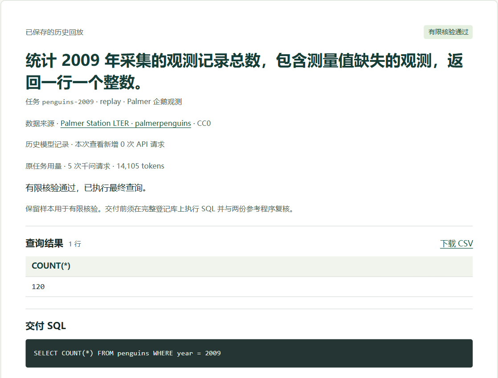
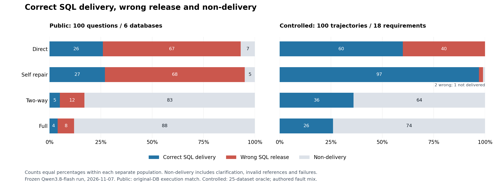

# DataVerify：面向 SQL 数据分析的核验与纠错 Agent

**用执行证据核验 SQL，定位分歧，并检查修复结果。**

基于 LangGraph 编排生成、核验与独立核算。模型根据任务编写参考计算和测试数据，本地工具执行 SQL 与参考程序；出现分歧时，再决定修改 SQL、替换参考版本或请求澄清。旧参考与反例始终保留，用于修复后的回归。

[使用指南](docs/USAGE.md) · [动态核验](docs/DISCOVERY.md) · [架构](docs/ARCHITECTURE.md) · [源码导览](docs/CODE_GUIDE.md) · [评测](docs/EVALUATION.md) · [变更记录](docs/CHANGELOG.md)

**试用 v1.1.0 工作台**　[下载体验包](https://github.com/repeatant/task-verified-data-agent/releases/download/v1.1.0/DataVerify-Workbench.zip)，解压后用 Python 3.12 运行 `python tools/start_workbench.py`。首次需联网安装 Python 依赖。从源码构建前端另需 Node.js。浏览器中可以从两个问题开始。[安装与运行](docs/WORKBENCH.md)

- **等额订单明细能去重吗？** 在订单示例库选择明细计数，查看错误 SQL、触发修订的证据，以及修复后的结果。
- **有多少条企鹅观测记录可用于分析？** 在 Palmer Penguins 公开数据中先检查原始样本，再说明是否要求有体重值。344 条观测中有 342 条记录了体重。可下载已核验的结果并与原始数据核对。[数据来源与许可](https://allisonhorst.github.io/palmerpenguins/)

两个库均提供离线示例。启用带预算的千问实时模式可输入自定义问题。工作台另附历史千问回放，可以逐步查看模型决策。

[](docs/WORKBENCH.md)

一次实验发现，模型将辅助调查与签核依据混填，有时会导致正确的 SQL 被拒绝交付。分栏后，四个已知决策点的正确交付从 1 次增至 4 次，普通流程两个决策点均为 2 次。工作台保留了可逐步查看的配对回放。[分栏实验及共错边界](docs/experiments/SPLIT_SIGNOFF_20261121.md) · [末轮决策实验](docs/experiments/TERMINAL_DECISION_20261121.md)

v1.0.0 的运行路径仅使用 LangGraph；DB-GPT 安装、运行入口及适配层已移除，旧实验单独归档。

## 如何工作

- **隔离上下文**：生成方不读取参考程序；独立核算只读取需求和无答案的数据；规划、归因与常规复核分别构建请求。
- **执行分歧**：SQLite 执行 SQL，受限解释器执行参考程序。Hypothesis 搜索并缩减能区分计算结果的数据。
- **定向修改**：依据需求引文与实际执行记录选择修改对象；替换参考时保留版本及全部反例，不能删除失败测试获得通过。
- **重放与恢复**：检查点绑定任务、数据、配置和代码版本；恢复后重新检查结果，未决付费请求不自动重发。

支持受约束的多表 SQLite schema、只读查询与有边界的数据预览；固定的 `orders` / `order_lines` 路径保留用于受控演示。模型仍可能共同误解需求，`reviewed` 只表示有限检查通过，不是语义正确性证明。当前项目用于研究核验流程、执行证据和失败模式，扩展评测尚未显示优于简单基线的正确交付效果。

## 快速开始

已验证开发环境为 Windows、Python 3.12。以下命令在仓库根目录执行，均不调用模型 API。

```powershell
python -m venv .venv
.\.venv\Scripts\python.exe -m pip install -r requirements/core.lock.txt -r requirements/probes.txt

# 重放动态核验与修复
.\.venv\Scripts\python.exe tools/evaluate_discovery.py --track controlled
.\.venv\Scripts\python.exe tools/evaluate_discovery.py --track correct
.\.venv\Scripts\python.exe tools/evaluate_reference_audit.py
```

离线响应由脚本提供，用于检查控制流，不衡量模型能力。第三条命令覆盖九种故障注入场景，包含错误参考、错误 SQL、明确舍入要求，以及共同误解且无确认样例时的已知漏检。

预设性质路径可以单独运行，适合观察一条日期边界错误的生成、核验、反馈与修复：

```powershell
.\.venv\Scripts\python.exe tools/run_graph.py --case d06 --thread boundary-demo
.\.venv\Scripts\python.exe tools/replay_probe.py tests/fixtures/public_evidence/date_boundary.json
```

第二条命令的 `reproduced: true` 表示错误被重现，不表示 SQL 通过。真实模型配置见 [使用指南](docs/USAGE.md)，预设性质路径的断点恢复见 [LangGraph 指南](docs/LANGGRAPH.md)。

## 验证结果

2026-11-07 完成扩展冻结评测：100 条公开问题来自 6 个数据库，另有 100 条受控故障轨迹（18 个原始需求）。四个协议与三项预选消融合计 980 条方法轨迹；另完成 20 条稳定性重复，原始失败全部保留。独立离线复算与账本审计无差异。

下列分别为“正确 SQL 交付 / 错误交付 / 未交付”，两种样本各自以 100 为分母：

- **公开题**：直接生成 `26 / 67 / 7`；自修复 `27 / 68 / 5`；两路核验 `5 / 12 / 83`；完整协议 `4 / 8 / 88`。
- **受控故障**：直接法 `60 / 40 / 0`；自修复 `97 / 2 / 1`；两路核验 `36 / 0 / 64`；完整协议 `26 / 0 / 74`。受控初始程序及故障比例为人为设置，不能当作自然任务准确率。

**完整协议的主要问题是未交付过多，而且公开题的已交付结果仍有 8/12 错误。** 初始正确的公开 SQL 有 23/26 未交付；受控独立核算错误的 20 条全部未交付，当前策略没有直接修复独立核算的出口。这不只是输出格式问题，不能将阻断率包装成通用纠错能力。



配对区间、消融、失败分层、稳定性与费用口径见[扩展评测报告](docs/experiments/EXPANDED_RESULTS.md)，数字和图可由[公开摘要](docs/experiments/expanded-results/summary.json)重现。未观察到错误交付的受控小样本不证明错误风险为零。

随后在预选的 40 条新问题上，仅比较普通 JSON 与严格 JSON Schema：普通模式正确交付 `1/40`，严格模式 `0/40` 且错误交付 `2/40`；两组首参考接受数均为 `28/40`。没有证据支持默认启用严格模式，适配器保持显式可选，默认关闭。这是四个既有 schema 内的新题确认，不是新数据库测试。见[确认报告与完整费用口径](docs/experiments/STRUCTURED_CONFIRMATION_RESULTS.md)。

上述指标归属于各自冻结快照。后续加入的 Windows 原子文件替换有限重试仅做离线工程验证，没有重跑失败任务或回填评测结果；当前工作目录不宣称与旧冻结源码逐字一致。

实验分支新增了可选的[三方分歧处理入口](docs/DISPUTE_RECOVERY.md)，允许诊断角色查询数据并修订独立核算。六条受控开发轨迹中，正确交付为旧流程 3/6、新流程 4/6、简单自审 6/6；修复检查引用接口后，原始响应离线回放为 5/6，不计入新实测成绩。原主流程保持不变，详见[开发对照与限制](docs/experiments/DISPUTE_RECOVERY_RESULTS.md)。

### 较早的冻结开发评测

同日较早完成的评测覆盖 4 类公开开发需求、16 条受控任务和 4 条自然任务，单独保留其范围与结果：

- **定向修复**：单边 SQL 错误修复 4/4，单边参考错误纠正 4/4；8 条初始正确 SQL 均未被改错，其中 7 条完成交付。
- **共同错误**：单参考检查会放行的 4 条共同错误均被独立核算发现分歧，转为待澄清，没有自动修复或发布。
- **保留失败**：受控任务正确交付 11/16；自然任务 SQL 正确交付 3/4、三份计算均正确交付 2/4。两条任务耗尽复核轮次，一条自然参考仍有舍入错误。

逐任务使用 31 组边界与固定随机数据评分。整轮实际调用 78 次、消耗 143,082 Token；这些是有限开发场景的结果，不代表生产准确率。见[冻结评测报告](docs/experiments/V1_FROZEN_RESULTS.md)与[可重放证据](tests/fixtures/discovery/v1_frozen_evaluation.json)。

### 先前的 v1.0.0 开发联调

v1.0.0 的真实千问联调覆盖主要执行分支：

- **参考与 SQL 分开修复**：三条受控任务分别完成错误参考替换、错误 SQL 修复和明确舍入保留；最终 SQL、当前参考与独立核算均通过七组开发评分数据。
- **自然生成**：订单去重任务的 SQL、参考计划与独立核算均由模型生成，源数据结果为 `3`；三种计算均通过七组开发评分数据。
- **跨进程恢复**：预设性质任务 `d03` 用一次真实调用生成 SQL，暂停后在新进程恢复并核验，恢复阶段新增模型请求为零。

首轮参考任务因非法 DSL 语法未完成；完善通用 AST 诊断后补测，失败记录同样保留。本轮共 26 次真实 HTTP 调用、53,194 Token，属于迭代后的开发联调，不是一次冻结评测的成功率。详见 [本版公开证据](tests/fixtures/discovery/v1_live_validation.json)与[评测说明](docs/EVALUATION.md)。

历史反馈压缩对照来自已移除的 DB-GPT 路径，不归到 LangGraph 或动态核验。实验分组、失败和历史数据见 [评测说明](docs/EVALUATION.md)。

## 目录结构

```text
dataverify/          Python 源码
  agent/             LangGraph 编排、角色上下文与恢复
  verification/      SQL 执行、参考计算、反例与验收
  integrations/      模型 API 配置与客户端
  evaluation/        开发样例与独立评分
  runtime/           预算与运行报告
docs/                使用、架构、评测与贡献指南
  history/           旧实验及来源记录
requirements/        依赖与锁定版本
tests/
  fixtures/          可重放样例、公开证据与冻结历史实现
tools/               离线演示、评分与显式真实模型入口
```

从 [动态图入口](dataverify/agent/discovery_graph.py) 或 [源码导览](docs/CODE_GUIDE.md) 开始阅读。测试约定见 [贡献指南](docs/CONTRIBUTING.md)，依赖与方法来源见 [第三方声明](docs/THIRD_PARTY_NOTICES.md)。
