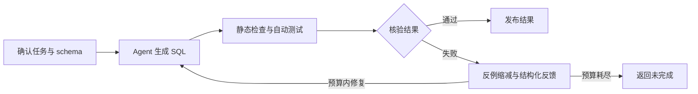

# Task-Verified Data Agent

**为 SQL 数据分析 Agent 提供任务核验、反例诊断与反馈修复。**

项目基于 DB-GPT，将查询执行、任务约束、自动测试和修复回归接成闭环。调用方确认指标与统计范围，Agent 生成 SQL，核验器检查候选并返回可重放的失败证据。

[快速开始](#快速开始) · [使用指南](docs/USAGE.md) · [架构](docs/ARCHITECTURE.md) · [反馈策略](docs/FEEDBACK.md) · [评测](docs/EVALUATION.md)

## 一个日期边界错误

任务要求统计九月已结算的明细净额，包含退款。下面的上界会把十月一日零点也算进去：

```sql
WHERE l.status = 'settled'
  AND l.settled_at >= '2026-09-01T00:00:00'
  AND l.settled_at <= '2026-10-01T00:00:00'
```

核验器为候选构造一个反例：原数据的净额为 1，添加一条十月一日零点、金额为 1 的明细后，候选结果变成 2，违反“范围外记录不影响结果”的任务性质。

缩减后的证据共两个订单、两条明细，可独立重放。修复阶段将失败性质、输入数据和实际结果反馈给模型；新候选继续接受原任务和已有反例的回归检查。

[查看反例数据](examples/public_evidence/date_boundary.json) · [另一个案例：渠道范围修复](examples/public_evidence/scope_repair.json)

## 核心能力

- **任务级核验**：检查时间、状态、金额来源、筛选范围和分组成员，区分合法零值与外连接产生的伪分组。
- **反例生成与缩减**：生成满足主外键和类型约束的数据，用变形关系诊断候选；保留失败性质，缩减反例数据。
- **反馈修复与回归**：组织结构化修复指导；连续失败时可从紧凑反例升级到完整证据，修复后回归原要求与历史反例。
- **受控执行**：通过 AST 白名单、只读 SQLite、查询与模型调用预算约束执行，由核验器持有并发布最终结果。

## 工作流程



生成、记忆和重试使用 DB-GPT 原生循环；核验与反馈通过 Action 接口接入。实现细节见 [架构文档](docs/ARCHITECTURE.md)。

## 快速开始

环境：Windows、Python 3.12。在仓库根目录安装依赖并重放上面的反例：

```powershell
python -m venv .venv
.\.venv\Scripts\python.exe -m pip install -r requirements.lock.txt -r requirements-probes.txt
.\.venv\Scripts\python.exe tools/replay_probe.py examples/public_evidence/date_boundary.json
```

预期输出包含以下字段：

```json
{
  "reproduced": true,
  "property_id": "exclude_end",
  "record_count": 4,
  "queries": 2,
  "real_model_used": false
}
```

此命令在本地重放失败性质，不调用模型 API。完整 Agent 闭环、真实模型配置和测试命令见 [使用指南](docs/USAGE.md)。

## 验证结果

- **反馈压缩**：`legacy_v1` 的 16 组受控反例配对中，两种反馈均修复 14/16，紧凑反馈的实际输入 Token 减少 **7.0%**；另 3 项自然任务中，完整反馈完成 3/3，紧凑反馈完成 2/3。
- **反馈消融**：四种配置在两个受控错误上均修复成功；LEFT JOIN 案例的真实修复调用由 **2 次减至 1 次**，另一案例轮次不变。
- **状态升级**：完整、紧凑、自适应策略在三个开发任务上均 3/3 正确；本轮未触发升级，自适应效果仍待连续失败任务验证。
- **查询挑战**：24 项独立编写的冻结挑战中，初次判定正确 21 项，发现 3 条错误放行；修复后同组转为回归，24/24 通过，3 条原错误候选由真实模型反馈修复 3/3。

以上为固定 schema 的合成开发任务。完整分组、Token 开销、一次自然任务响应截断及错误放行分析见 [评测说明](docs/EVALUATION.md)，实现与运行方法见 [反馈策略](docs/FEEDBACK.md)。

## 支持范围

当前覆盖 SQLite 订单与明细父子表的净额、逐订单和逐渠道统计，支持受限 `SUM`、筛选、单次 INNER/LEFT JOIN 与单键分组。任务条件由调用方确认。

完整语法、输入约束和执行边界见 [执行契约](docs/ARCHITECTURE.md#执行契约)。

## 文档与源码

- [使用指南](docs/USAGE.md)：安装、离线示例、模型 API、测试与评测入口。
- [架构与执行契约](docs/ARCHITECTURE.md)：组件职责、支持范围和源码导览。
- [反馈机制与消融](docs/FEEDBACK.md)：独立信息开关、状态升级与配对实验。
- [评测说明](docs/EVALUATION.md)：真实调用对照、独立挑战、回归与版本回放。
- [核验入口](dataverify/probe_guard.py)：任务保持、候选验收和发布结果。
- [Agent 接入](dataverify/probe_agent_bridge.py)：资源、Action 与反馈循环。

## 依赖与参考

[DB-GPT](https://github.com/eosphoros-ai/DB-GPT) 提供 Agent 循环，[SQLGlot](https://github.com/tobymao/sqlglot) 提供 SQL AST，[Hypothesis](https://github.com/HypothesisWorks/hypothesis) 提供数据生成与缩减工具。测试方法参考 [SQLDriller](https://github.com/SJTU-IPADS/SQLDriller) 和 [SQLancer](https://github.com/sqlancer/sqlancer)。

第三方版本与许可见 [THIRD_PARTY_NOTICES.md](THIRD_PARTY_NOTICES.md)。本仓库代码的许可证尚未指定。
