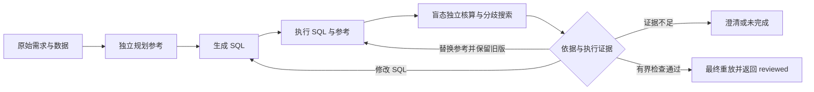

# 架构与执行契约

## 两种任务契约，一个编排框架

当前 Agent 编排只使用 LangGraph。动态参考核验和预设性质核验各自拥有状态图，不能将两者的语法能力、验收状态或实验成绩混为一谈。

- **动态路径**：`run_discovery` 根据原始问题生成参考计算与测试，再独立生成 SQL。盲态核算检查参考自身；分歧通过执行证据归因，获准后修改 SQL 或替换参考，否则澄清。
- **预设性质路径**：`run_graph_case` 接收调用方已确认的 `ProbeTask`，按 `prepare_call → generate → verify → feedback/publish` 运行，使用登记性质及原验收条件。

生成方不接收参考，独立核算不接收候选 SQL、参考或答案。规划、归因、常规复核分别组织上下文；归因按设计接收双方程序与执行差异。相同模型仍可能共同误解，程序一致不等于业务正确。

两条路径均使用文本结构化 JSON，由本地代码分发动作；不是供应商原生 Function Calling。当前没有 DB-GPT 运行层，冻结旧源码仅用于历史离线回放。

动态 SQL 范围、参考解释器、确认样例和修改权限见 [动态核验指南](DISCOVERY.md)。下文“执行契约”专指预设性质路径。

## 预设性质路径的状态与恢复

`GraphState` 只保存可序列化数据，模型客户端、凭据、锁和活动 Guard 均在状态之外。恢复先比对任务／数据摘要、执行选项及运行时代码与依赖版本；不一致时要求新建线程。

Guard 检查点保留实际反例及反馈升级进度，不恢复已接受结果。候选必须在当前来源及已存反例上重新执行，才有发布资格。已完成线程再次读取时也重新核验，避免把缓存数值当作当前结果。

模型调用前，独立节点先同步保存待调用标记；实际 POST 前，费用代理将预留额落盘。重启后使用最新完整账本，不回退到较旧图状态里的预算。存在未决调用、未知 usage 或未完成节点时拒绝自动重试。这里不提供付费请求的 exactly-once 保证；已完成 HTTP 但图节点未保存结果时也需要人工检查。

本地文件锁串行化检查点与共享预算的写入。SQLite 方案面向本地演示和开发；运行命令、断点示例和边界见 [LangGraph 指南](LANGGRAPH.md)。

## 预设性质核验组件

- **任务和 AST 分析**：SQLGlot 解析候选，检查表、列、关联、聚合、筛选和输出形式。必要条件之外的额外范围限制同样需要检查。
- **数据生成与性质测试**：为登记性质生成合法的源数据和跟随数据，例如添加范围外记录、合法退款或没有有效明细的订单，检查预期关系是否成立。
- **配对反例缩减**：使用 Hypothesis 缩减失败输入，同时保留新增见证记录、主外键合法性和同一失败性质。完整与紧凑反例可分别用作修复反馈。
- **修复回归**：新候选必须保留原任务要求，并通过源数据、历史反例和输出形状检查。候选变更会先撤销旧的接受状态。
- **反馈选择**：完整执行契约与分类指导可分别开启；自适应模式按重复候选、持续同类错误或连续失败升级证据，状态仅在当前任务内保存。所有策略共用验收条件与尝试预算，见 [反馈机制](FEEDBACK.md)。
- **执行和发布控制**：只读内存 SQLite、AST 白名单、本地查询预算和模型调用预算分别控制执行。任务漂移、来源变化、检查失败或运行异常均不会发布候选数值。

任务性质是可验证的必要条件；测试通过仍不等于完整语义证明。当前实验中，动态测试提供了可重放诊断与反馈压缩证据，新增检错收益尚未得到证明。

## 执行契约

以下为预设性质路径的契约；动态路径仍使用相同两张表，但允许更宽的表达形式，见 [动态范围](DISCOVERY.md#检查逻辑为什么不再写死)。

当前数据为固定的 `orders`、`order_lines` 父子表，金额使用有界整数最小单位，退款可为负数。主键为正整数，明细外键有效；时间为无时区的 ISO 秒字符串。

支持的任务形式：

- 指定状态和半开时间范围内的明细净额。
- 按订单统计，保留没有有效明细的订单及其零值。
- 按渠道统计有效明细，归并 NULL 与指定的同名渠道。

支持单个直接字段 `SUM(order_lines.amount)`、可选 `COALESCE(...,0)`、最多一个登记的 INNER/LEFT JOIN、受限 AND 筛选和单键分组。CASE、CTE、子查询、窗口、UNION、DISTINCT、算术表达式、ORDER BY、LIMIT及任意函数不在当前执行范围内。

LEFT JOIN 按驱动表、过滤位置和可选侧匹配关系核验。`line_id>0` 等由输入约束可证明的条件可以充当匹配见证；任意渠道或 ID 门槛则可能缩小任务范围。真实零金额组和外连接补出的无明细零额组分别处理。

完整语法与边界检查位于 [probe_runtime.py](../dataverify/verification/probe_runtime.py)，模型可见的能力描述位于 [probe_capabilities.py](../dataverify/verification/probe_capabilities.py)。

## 代码导览

- [discovery_graph.py](../dataverify/agent/discovery_graph.py)：动态状态图、上下文与最终重放。
- [discovery_audit.py](../dataverify/agent/discovery_audit.py)：独立核算、归因和参考替换。
- [reference_expression.py](../dataverify/verification/reference_expression.py)：受限参考计算解释器。
- [reference_audit.py](../dataverify/verification/reference_audit.py)：三方执行、确认样例与区分数据搜索。
- [probe_runtime.py](../dataverify/verification/probe_runtime.py)：预设任务、AST、只读执行和范围约束。
- [probe_testing.py](../dataverify/verification/probe_testing.py)：登记性质的数据生成及反例缩减。
- [probe_guard.py](../dataverify/verification/probe_guard.py)：任务保持、反例回归与发布。
- [probe_langgraph.py](../dataverify/agent/probe_langgraph.py)：预设性质节点、条件路由和恢复。
- [graph_model.py](../dataverify/agent/graph_model.py)：单次 JSON 生成、脚本及千问适配。
- [graph_checkpoint.py](../dataverify/agent/graph_checkpoint.py)：本地锁与持久预算。

评测目标、故障标签和参考答案位于独立评测模块，运行时模块不导入评分答案。

## 依赖分工

[LangGraph](https://github.com/langchain-ai/langgraph) 提供图编排和检查点；[SQLGlot](https://github.com/tobymao/sqlglot) 提供 AST；[Hypothesis](https://github.com/HypothesisWorks/hypothesis) 提供生成与缩减。SQL 执行使用 SQLite，参考计算使用项目内受限解释器。

早期 `engine.py`／FastAPI 示例仍保留旧任务模型，不是当前动态核验服务入口。历史实验与当前依赖分开，见 [评测说明](EVALUATION.md) 和 [第三方声明](THIRD_PARTY_NOTICES.md)。
