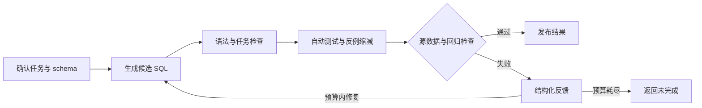

# 架构与执行契约

## 一次任务如何执行

调用方先确认指标、时间、状态、输出形式和任务性质。DB-GPT 生成候选 SQL，核验组件返回结构化结果；失败反馈进入原生重试，修复候选继续接受同一任务和已发现反例的检查。

执行动作扩展自 DB-GPT 的 `Action` 接口，复用原生生成、记忆和重试循环。模型输出文本 JSON Action，查询由核验器执行，公开结果也由核验器持有。

## 核验组件

- **任务和 AST 分析**：SQLGlot 解析候选，检查表、列、关联、聚合、筛选和输出形式。必要条件之外的额外范围限制同样需要检查。
- **数据生成与性质测试**：为登记性质生成合法的源数据和跟随数据，例如添加范围外记录、合法退款或没有有效明细的订单，检查预期关系是否成立。
- **配对反例缩减**：使用 Hypothesis 缩减失败输入，同时保留新增见证记录、主外键合法性和同一失败性质。完整与紧凑反例可分别用作修复反馈。
- **修复回归**：新候选必须保留原任务要求，并通过源数据、历史反例和输出形状检查。候选变更会先撤销旧的接受状态。
- **反馈选择**：完整执行契约与分类指导可分别开启；自适应模式按重复候选、持续同类错误或连续失败升级证据，状态仅在当前任务内保存。所有策略共用验收条件与尝试预算，见 [反馈机制](FEEDBACK.md)。
- **执行和发布控制**：只读内存 SQLite、AST 白名单、本地查询预算和模型调用预算分别控制执行。任务漂移、来源变化、检查失败或运行异常均不会发布候选数值。

任务性质是可验证的必要条件；测试通过仍不等于完整语义证明。当前实验中，动态测试提供了可重放诊断与反馈压缩证据，新增检错收益尚未得到证明。

## 执行契约

当前数据为固定的 `orders`、`order_lines` 父子表，金额使用有界整数最小单位，退款可为负数。主键为正整数，明细外键有效；时间为无时区的 ISO 秒字符串。

支持的任务形式：

- 指定状态和半开时间范围内的明细净额。
- 按订单统计，保留没有有效明细的订单及其零值。
- 按渠道统计有效明细，归并 NULL 与指定的同名渠道。

支持单个直接字段 `SUM(order_lines.amount)`、可选 `COALESCE(...,0)`、最多一个登记的 INNER/LEFT JOIN、受限 AND 筛选和单键分组。CASE、CTE、子查询、窗口、UNION、DISTINCT、算术表达式、ORDER BY、LIMIT及任意函数不在当前执行范围内。

LEFT JOIN 按驱动表、过滤位置和可选侧匹配关系核验。`line_id>0` 等由输入约束可证明的条件可以充当匹配见证；任意渠道或 ID 门槛则可能缩小任务范围。真实零金额组和外连接补出的无明细零额组分别处理。

完整语法与边界检查位于 [probe_runtime.py](../dataverify/probe_runtime.py)，模型可见的能力描述位于 [probe_capabilities.py](../dataverify/probe_capabilities.py)。

## 代码导览

- [probe_runtime.py](../dataverify/probe_runtime.py)：任务与数据类型、AST检查、只读执行和范围约束。
- [probe_testing.py](../dataverify/probe_testing.py)：性质选择、合法数据生成、成对执行、反例缩减。
- [probe_guard.py](../dataverify/probe_guard.py)：任务保持、输出检查、旧反例回归和发布结果。
- [probe_agent_bridge.py](../dataverify/probe_agent_bridge.py)：DB-GPT资源、Action、反馈及最终发布接口。
- [probe_live_benchmark.py](../dataverify/probe_live_benchmark.py)：真实模型和脚本客户端对照、独立评分、调用审计。
- [probe_cost_budget.py](../dataverify/probe_cost_budget.py)：调用前预留、usage和估算费用账本。
- [feedback_experiment.py](../dataverify/feedback_experiment.py)：信息开关消融、固定与自适应反馈对照、累计预算续接。

评测目标、故障标签和参考 SQL 位于独立评测模块，运行时核验模块不导入这些目标。

## 依赖分工

[DB-GPT](https://github.com/eosphoros-ai/DB-GPT) 提供原生 Agent 循环；[SQLGlot](https://github.com/tobymao/sqlglot) 提供 AST；[Hypothesis](https://github.com/HypothesisWorks/hypothesis) 提供生成与缩减工具。固定上游提交及关键源码摘要保存在 [版本记录](research/dbgpt_pin.json)。

早期 LangGraph/FastAPI 实现保留在仓库中，其环境与当前 DB-GPT 路线分开。测试和安装入口见 [使用指南](USAGE.md)。
