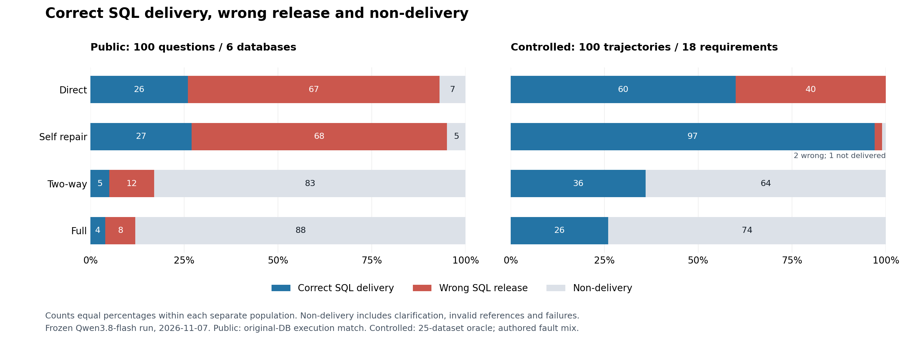

# 评测说明

当前执行路径只使用 LangGraph。动态参考核验与预设性质核验使用不同契约，分别评价，不合并计算准确率。离线脚本证明控制流可运行；真实模型轨迹说明具体行为，两者不能互换。

## 扩展冻结评测：主实验与稳定性已完成

100 条 BIRD Mini-Dev 公开问题来自 6 个数据库；100 条受控轨迹来自 20 个任务/故障组合、18 个原始需求。四个完整协议覆盖全部输入，三项消融只覆盖预选的 20 条公开题及 40 条受控轨迹，共 980 条方法轨迹。另对预先选定的十条任务各重复两次，共 20 条额外轨迹。主实验、重复实验的独立复算和来源/预算审计均通过，不删除质量失败或网络失败。

公开题各方法“正确 SQL 交付 / 错误交付 / 未交付”为：直接生成 `26/67/7`，单模型自修复 `27/68/5`，两路核验 `5/12/83`，完整协议 `4/8/88`。完整协议相对前三项的正确交付差为 −22、−23、−1 个百分点，配对 95% 区间分别为 `[-31,-14]`、`[-32,-14]`、`[-5,3]`。**本轮未证明完整协议具有更好的正确交付能力。** 它放行的 12 条中仍有 8 条错误，不能用拒绝 88 条来宣称高可靠性。

受控故障相应结果为：直接法 `60/40/0`，自修复 `97/2/1`，两路核验 `36/0/64`，完整协议 `26/0/74`。未观察到错放不代表总体风险为零；零事件经验 bootstrap 区间 `[0,0]` 在此不能提供有用的总体风险上界。直接法的 60/40 由注入比例决定，不是自然任务率。

完整协议中，初始正确 SQL 的未交付数为公开 23/26、受控 44/60；受控独立核算错误 20 条全部未交付。归因动作只处理候选 SQL、首参考或无法判断，没有直接修复独立核算的出口。格式/DSL/引文问题与这一决策缺口需要分别处理。稳定性中，十条任务有七条终态变化、四条正确交付状态变化；温度零不保证流程确定。



[完整结果、区间与失败分析](experiments/EXPANDED_RESULTS.md) · [预注册方案](experiments/EXPANDED_PROTOCOL.md) · [数据范围与来源](experiments/PUBLIC_DATA_SUPPORT.md) · [公开汇总 JSON](experiments/expanded-results/summary.json) · [基线 CSV](experiments/expanded-results/expanded_baselines.csv)

审计快照截至主实验和稳定性结束，后续确认实验不在以下费用内：主实验 2,264 次实际去重请求、6,390,609 个已知 Token，另有 8 次用量未知；稳定性 102 次请求、346,946 Token、用量完整。包含前期开发的累计已知估价 ¥7.8629735，保守预留 ¥88.4240656/¥120。估价、保守预留和真实云账单不同；未知用量未被当作免费调用。

后文较早的开发评测和联调均按原版本保留，不与本轮合并成功率，也不以历史成功案例覆盖本轮负面结果。

## 后续确认：严格输出格式未改善交付

在结果分析前预选的 40 条新题（四个既有数据库，分布为 18/18/2/2）上，两种模式共享初始 SQL，分别生成首参考并执行相同完整核验协议。唯一计划内变量为普通 JSON 与严格 JSON Schema 输出约束；80/80 条轨迹及完整原库 SQL 复算已通过独立审计。

普通模式正确交付 1/40、错误交付 0、未交付 39；严格模式正确交付 0/40、错误交付 2、未交付 38。“严格减普通”的正确交付差为 −2.5 个百分点，配对 95% 区间 `[-7.5,0]`；错放差为 +5 个百分点，区间 `[0,12.5]`。两组首参考接受均为 28/40，累计验证失败尝试为 62 与 65 次；接受包含 DSL/fixture 校验，不是纯 JSON 合规率或语义正确率。**没有支持默认启用严格模式的证据，选项保持默认关闭。**

确认计时为首参考生成加后续核验，排除共享 SQL：普通/严格模式中位数为 20.62/22.97 秒，P95 为 45.90/43.88 秒；不能将其与主实验排除首参考的后初始化计时直接相比。实际含 smoke 的去重请求 386 次、1,788,759 Token，新增用量完整。

[确认设计、区间与限制](experiments/STRUCTURED_CONFIRMATION_RESULTS.md) · [脱敏摘要](experiments/structured-confirmation/summary.json) · [比较 CSV](experiments/structured-confirmation/comparison.csv)

截至全部主实验、稳定性与确认实验结束，全历史累计保守预留 **¥108.950656/¥120**；已知用量估价 **¥9.5379711**，另有 8 次历史未知用量预留 **¥0.2328576**。已知估价加未知预留为 **¥9.7708287**，不是实际云账单。旧快照不重复计费，未知请求不算免费，失败记录未覆盖；全部 HTTP 事件与账本已核对，最终无在途请求或停止标记。

### 实验后工程收口

当前源码合入了默认关闭的严格 Schema 选项，以及 Windows 原子替换遇到特定共享/权限冲突时的有限重试（总等待上限 310ms）。后者只重试本地文件替换，不重发模型请求。工程回归共 1,659 项通过；后续仅格式化预算 driver 与测试文件后，相关 59 项定向测试再次通过。

这些是实验之后的工程调整，没有重跑失败轨迹或把修复效果填回 benchmark。各版 driver 源码、冻结 zip 和原始审计记录保持原样，工作目录与历史冻结源码不同是预期状态。复核历史指标应使用相应冻结快照，不能用当前源码摘要替代它。

## v1 冻结开发评测（2026-11-07）

本轮按预注册方案完成 16 条受控任务和 4 条自然任务，共 78 次真实请求、143,082 Token，运行中没有修改提示词、重跑任务或删除失败。受控组中单边 SQL 错误修复 4/4、单边参考错误纠正 4/4；4 条共同错误均被发现分歧并阻止发布，但没有自动修复。8 条原本正确的 SQL 保持语义正确，其中 7 条交付。

受控任务正确交付 11/16；自然任务 SQL 正确交付 3/4，SQL 与两份参考均正确交付 2/4。一条自然参考存在额外舍入，两条任务耗尽复核轮次，均完整保留。每条结果另用 31 组数据评分；这些数据不是 31 个独立任务。

[完整结果与局限](experiments/V1_FROZEN_RESULTS.md) · [预注册方案](experiments/V1_FROZEN_PROTOCOL.md) · [脱敏可重放证据](../tests/fixtures/discovery/v1_frozen_evaluation.json)

本轮最终离线回归 1,180 项通过，Ruff 检查和格式检查通过。新增 103 项测试覆盖评测器、费用继承与公开记录重放；测试数量不计入模型任务准确率。

## v1.0.0 真实 API 联调（2026-11-07）

本轮在仅含 LangGraph 的运行路径上调用真实千问，验证主要执行分支。首轮和补测分开记录，不以最后成功的轨迹替代失败历史。

- 首轮 `wrong_reference_rounding`：3 次请求后因参考程序使用非法 DSL 语法未完成。
- 通用 AST 诊断完善后，同一任务补测使用 6 次请求：保留正确 SQL，替换错误参考并保留旧版本。
- `wrong_sql_grain` 使用 6 次请求修复 SQL 的统计粒度，保留正确参考。
- `requested_rounding` 使用 5 次请求保留需求明确要求的舍入，未把所有舍入都当作错误。
- `distinct_orders` 使用 5 次请求完成自然生成，源数据输出 `[[3]]`；除内置五组 SQL 评分外，SQL 与两份参考通过七组开发评分数据。
- 固定路径 `d03` 使用 1 次请求自然生成 SQL，在 `verify` 后暂停并跨进程恢复；恢复新增请求为零。

三条完成的参考审查任务和自然任务在运行结束后同时核验最终 SQL、当前参考和独立核算，均通过七组开发评分数据：源数据及六组补充数据，覆盖粒度、空输入、循环小数、半值舍入、退款和边界。初始 SQL 与首版参考在三条审查任务中为受控注入；自然任务没有这两项注入。检查点的两份进程报告属于同一个恢复任务，不能当作两个独立样本。

本轮合计 26 次 HTTP 调用、53,194 Token，全部 usage 完整。沿用本地账本标价估算的增量为 0.0610118 元，累计估价为 0.4589466 元；保守预留累计为 4.9928016 / 5 元。估价与预留不是云控制台实际扣费，不通过重新建立账本重置累计消费。

脱敏记录见 [v1.0.0 联调证据](../tests/fixtures/discovery/v1_live_validation.json)。原始私有报告保存在本地 `reports/v1-live-20261107/`，不随源码发布。这些是包含诊断改动和补测的开发联调，没有覆盖所有任务组合，也不能推算模型准确率。

## 历史参考审查开发记录

九种离线场景检查错误参考替换、正确 SQL 保留、错误 SQL 修复、明确舍入要求和共同误解。无确认样例时仍可能错误放行，作为已知失败保留。

真实千问实验受控注入初始 SQL／参考，随后独立核算、归因与修改调用模型。六条开发记录包含格式中止、半值舍入错误和后续补测；三条最终选定轨迹分别完成参考替换、SQL 修复和明确舍入保留，不能按这三条计算冻结成功率。

[reference_audit_scoring.py](../dataverify/evaluation/reference_audit_scoring.py) 在运行后同时检查 SQL、当前参考和独立核算。三条最终轨迹通过七组开发数据，包含粒度、空数据、精度、退款及边界；评分答案不进入当次模型上下文，但数据参与了迭代分析，不是独立留出集。

方法、开销、失败及上下文边界见 [动态核验指南](DISCOVERY.md#参考审查改造的实测与局限)，原始投影见 [参考审查证据](../tests/fixtures/discovery/reference_audit_evidence.json)。改造前曾出现 SQL 评分通过、参考程序仍错误舍入的问题，见 [历史动态证据](../tests/fixtures/discovery/live_evidence.json)。

## 预设性质 LangGraph 执行与恢复

三项历史千问联调使用 `qwen3.8-flash`、`capability_v2`、自适应反馈及最多三个候选尝试：

- `d06`：受控日期上界错误，一次真实调用修复并通过历史反例回归。
- `d10`：受控 LEFT JOIN 过滤错误，一次真实调用修复并保留零值订单。
- `d03`：自然生成后暂停，在另一进程恢复、重新核验并发布；恢复阶段新增 HTTP 为零。

四份进程报告对应三个任务。两个受控首轮不算模型生成，实际 HTTP 共 3 次、3,479 Token，usage 完整。源数据、发布 SQL 一致性及附加边界数据评分通过，见 [联调证据](../tests/fixtures/public_evidence/langgraph_validation.json)。

`tools/evaluate_graph.py` 对已保存的进程报告离线评分。恢复线程按一次任务统计，实际调用分别保留；评分器不进入运行时核验器或模型上下文。这项验证说明图路由与检查点连通，不证明框架更换提升修复率，也不承诺未决 HTTP 的自动恢复。

## 离线回归与冻结历史

```powershell
.\.venv\Scripts\python.exe tools/evaluate_reference_audit.py
.\.venv\Scripts\python.exe tools/evaluate_discovery.py --track controlled
.\.venv\Scripts\python.exe tools/evaluate_discovery.py --track correct
.\.venv\Scripts\python.exe tools/replay_probe.py tests/fixtures/public_evidence/date_boundary.json
.\.venv\Scripts\python.exe tools/replay_initial_challenge.py
.\.venv\Scripts\python.exe tools/evaluate_independent_holdout.py
```

最后两条分别重放冻结旧实现的 21/24，以及修复后的同题 24/24。新工具名仍带 `holdout`，但当前题目已经公开，运行结果是已知回归，不是新的留出成绩。当前回归会记录实际使用的核验源码摘要。

`tests/fixtures/independent_holdout/initial_verifier/` 及其 manifest 保持原样，包含旧适配文件；历史回放只加载纯核验组件，不需要 DB-GPT。旧 JSON 报告可用 `tools/audit_probe_workflow.py` 离线审计，它不运行当前 Agent，也不产生新版指标。

## 历史 DB-GPT 实验

旧反馈实验中，16 组有效配对的完整与紧凑反馈均修复 14/16；诊断字符减少 29.1%，实际输入 Token 减少 7.0%。另三项自然任务分别通过 3/3、2/3，因此不能宣称整体成功率不降。

这些结果及反馈消融来自已移除的 DB-GPT 路径，未在当前 LangGraph 版本重跑。完整分组、失败、范围及历史测试口径见 [历史实验档案](history/LEGACY_EVALUATION.md)。本次迁移不重写旧证据，不把框架移除计作算法提升。

## 适用范围

较早开发实验使用固定 `orders` / `order_lines` 表与合成数据；新增扩展实验覆盖声明支持范围内的六个 SQLite schema，采用完整原库 SQL 评分，但没有生产准确率证据，也没有证明适用于任意 schema/SQL。运行时仍只看到受限预览。预设检查是必要条件；动态生成的参考也可能错。上下文分离不保证统计独立，同一模型可能共同误解；多个程序一致不构成业务正确性证明。

先前的 v1.0.0 发布回归（2026-11-07）有 1,077 项通过，Ruff 检查及格式检查通过。工程回归在未安装 DB-GPT 的环境中运行；额外隔离测试阻断其导入、凭据读取和模型 HTTP 请求，并实际运行预设与动态两条 CLI 的修复流程。测试通过数衡量工程回归，不是模型准确率。上述开发评测后来记录的 1,180 项回归也保留其历史范围，不能替代本轮扩展模型评测。

本地生成的测试报告为 `reports/v1-live-20261107/final-regression.xml`，不随源码上传。测试另有一条 Hypothesis 关于 `.hypothesis` 收集排除的非失败警告。
