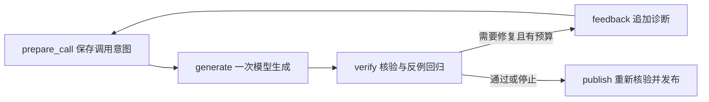

# LangGraph 执行与断点恢复

当前路径复用 `ProbeGuard`，将生成、核验、反馈、修复和发布组织为显式状态图。它与 DB-GPT 路径分别运行，共享任务数据类型、SQL 检查、自动测试、反例及验收规则。

## 安装与离线运行

Python 3.12，在仓库根目录执行：

```powershell
python -m venv .venv
.\.venv\Scripts\python.exe -m pip install -r requirements.lock.txt -r requirements-probes.txt
.\.venv\Scripts\python.exe tools/run_graph.py --case d06 --thread boundary-demo
```

`d06` 是公开开发案例。离线脚本先给日期边界错误候选，再给修复候选。预期最终 `publication.status=verified`，两次候选都经过核验，第二次额外回归第一次保存的反例。离线修复由预写响应提供，不计作模型能力。

线程标识与检查点文件共同确定一次运行。重复创建同名线程会拒绝覆盖；新建任务使用新的 `--thread`，读取原任务使用 `--resume`。

## 观察一次恢复

```powershell
# 第一次核验后暂停，不发布候选结果
.\.venv\Scripts\python.exe tools/run_graph.py --case d06 --thread resume-demo --pause-after verify

# 可以退出当前终端、重新打开，然后继续同一个线程
.\.venv\Scripts\python.exe tools/run_graph.py --case d06 --thread resume-demo --resume
```

恢复后会继续修复，先前的反例、尝试次数和反馈升级状态保留。已完成线程再次 `--resume` 不重新请求模型，发布前仍重查候选与已有反例。

## 节点与状态



状态包括来源摘要、运行时摘要、执行选项、消息、候选、尝试次数、反例与策略状态、费用快照和执行轨迹。凭据、HTTP 客户端和活动 Guard 不写入图状态。

调用方提供确认后的 `ProbeTask` 与 `ProbeData`；开发案例的参考 SQL 和目标结果仅由离线脚本／评分器使用，不进入真实模型上下文或运行时核验器。

## 真实千问调用

先按 [使用指南](USAGE.md#接入真实模型) 配置普通按量 API 环境变量。此路径无需安装 DB-GPT。实时运行必须显式选择 `--track`：

- `natural`：首轮 SQL 也由模型生成。
- `controlled`：首轮注入已知错误，后续修复才调用真实模型；报告明确区分这两种来源。

首次使用且没有历史实验开销时，可以显式创建本地额度。例如预留上限 0.1 元、最多两次 HTTP：

```powershell
.\.venv\Scripts\python.exe tools/run_graph.py --live --track natural --case d01 --thread first-live --budget-file artifacts/langgraph/budget.json --new-budget-cny 0.1 --max-extra-requests 2
```

已有实验开销时，首次创建此路径的费用文件应提供完整实验报告，以续接已消耗的次数、Token 与费用预留：

```powershell
.\.venv\Scripts\python.exe tools/run_graph.py --live --track natural --case d03 --thread live-demo --budget-file artifacts/langgraph/budget.json --prior-budget reports/your-completed-run/summary.json
```

后续运行使用同一个 `--budget-file`，不再提供 `--prior-budget`。恢复原线程须保持原配置：

```powershell
.\.venv\Scripts\python.exe tools/run_graph.py --live --track natural --case d03 --thread live-demo --budget-file artifacts/langgraph/budget.json --resume
```

费用文件是本地私有记账，不应放入 Git。已有账本不能再次指定初始化参数。不要通过新建费用文件清空自己已用的额度，也不要用别人的报告继承其账户额度。标准价估算与云账单不同，当前实验上限也不是服务商侧的扣费限制。

## 恢复保证与边界

- **保持任务**：任务、数据、反馈选项、尝试上限、核心代码或相关依赖版本变化，旧线程停止继续；需要新线程。
- **保持反例**：保存实际缩减后的成对数据及自适应失败进度，恢复时校验结构、性质归属和来源绑定。
- **重新验收**：不恢复 Guard 的已接受状态或直接发布缓存 rows；在当前来源及历史反例上重新运行 SQL。
- **保持费用**：实际 POST 前落盘预留；完整 usage 后更新同一个累计账本。本地锁避免两个进程同时改写。
- **拒绝未决调用**：进程若在模型节点中断，不能确定 HTTP 是否完成，恢复会拒绝自动重复请求。即使费用已经记录，响应未写入检查点时也不会擅自重调。

这是本地单机开发方案，未实现跨机器调度、服务端幂等键或付费请求的 exactly-once。文件损坏、主动回滚私有账本以及存储硬件故障不由此方案解决。

## 验证入口

```powershell
.\.venv\Scripts\python.exe -m pytest tests/test_probe_langgraph.py tests/test_graph_guard.py tests/test_graph_checkpoint.py tests/test_graph_model.py tests/test_graph_cli.py -q
```

测试覆盖原有开发案例、失败修复、反例与自适应状态恢复、来源／配置变化、旧结果撤销、未决调用拒绝、费用前缀检查和本地并发写入。真实模型结果单独列于 [评测说明](EVALUATION.md)。

实现依据：[LangGraph 检查点](https://docs.langchain.com/oss/python/langgraph/checkpointers)、[持久化边界](https://docs.langchain.com/oss/python/langgraph/persistence)、[AsyncSqliteSaver 源码](https://github.com/langchain-ai/langgraph/blob/main/libs/checkpoint-sqlite/langgraph/checkpoint/sqlite/aio.py)。
