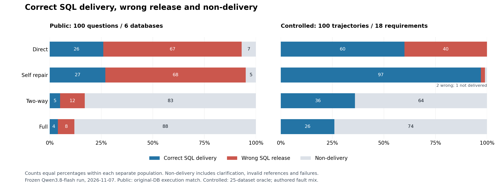

# 扩展冻结评测（2026-11-07）

**结论：当前完整核验协议没有取得更好的正确 SQL 交付效果。** 在公开的
100 题中，完整协议正确交付 4 题、错误交付 8 题、未交付 88 题。已交付的
12 题仍有 8 题错误，不能把大量拒绝解释为可靠性提升。在受控故障中，它保留了
初始正确 SQL，但经常无法完成核验和交付；这是一套可运行、可审计的核验工作流，
尚不是优于简单基线的通用纠错方案。

主实验 980 个预定方法轨迹及 20 个额外稳定性轨迹均已完成。独立审计重新计算
主实验和重复实验的 SQL/参考程序评分，并核对原数据库、冻结源码、初始缓存、
原始记录与费用事件：**零审计错误、零评分差异**。审计通过证明实验记录一致，
不代表模型任务通过。



[公开汇总 JSON](expanded-results/summary.json) ·
[四基线 CSV](expanded-results/expanded_baselines.csv) ·
[矢量图](expanded-results/expanded_delivery.svg) ·
[实验协议](EXPANDED_PROTOCOL.md) · [数据来源](PUBLIC_DATA_SUPPORT.md)

## 实验范围与冻结边界

- 模型为 `qwen3.8-flash`，温度 0，单次输出上限 1,800 Token。
- 主运行源码提交为 `3b1fab4`。`protocol.json` 字节 SHA-256 为
  `ea54972a6e1b10f4db5f0f2119430a09e63faea2a429a76b0c60441f8dfcd033`。
  原始运行保留 `frozen-source.zip`；公开汇总保存协议摘要和数据库摘要。
- 公开部分为 BIRD Mini-Dev 的预先限定支持范围中的 **100 题、6 个数据库**。
  开发阶段使用另外两个数据库的 20 题。完整 BIRD、任意 SQLite 查询和生产任务
  都不属于本次结论范围，也不声称数据未出现在模型预训练中。
- 受控部分为 **100 条故障轨迹、20 个任务/故障组合、18 个原始需求**。
  SQL 错、首参考错、共同错、独立核算错、初始全正确各 20 条。它们是人为设计的
  故障比例，不是实际业务故障的自然分布。
- 四个协议均运行全部 200 条输入；三项消融只运行预先选定的 20 条公开题和
  40 条受控轨迹，共 `200 × 4 + 60 × 3 = 980` 格。重复实验另外计算。

数据准备 manifest 存储每表最多十行预览；正式运行使用每表两条种子记录再做
外键闭包，并受预览大小限制。Agent 看到的是有边界的预览；公开 SQL 最终评分
在**完整原数据库**上执行。公开 gold、人工评分函数和评分数据均不进入模型上下文。

初始 SQL 与首版参考在可比较协议间共享；直接法和自修复不需要首参考的生成费用。
受控初始 SQL/参考为明示故障注入，不算自然模型生成。预算续跑只补充未执行单元，
或显式、完整计费的预算中断单元；原质量失败和未知用量的网络失败保留。
后续人工审核的已计费客户端错误也仍是失败记录。

## 四个基线做什么

- `direct`：直接交付共享初始 SQL，执行安全检查仍保留。
- `self_repair`：模型根据原任务自行复核/修改 SQL；不使用独立参考核验协议。
- `two_way`：SQL 与首参考之间的两路核验/修复协议。
- `full`：加入隔离的独立核算、反例搜索及基于执行分歧的归因授权。

`two_way` 与 `full` 是完整协议的比较，不是仅切换一行 Auditor 代码的严格消融。
`reviewed` 是运行时有限检查通过的状态；是否正确交付由独立评分器另外判断。

## 公开题：正确交付没有提升

以下每项分别为“正确交付 / 错误交付 / 未交付”，分母均为 100：

- `direct`：**26 / 67 / 7**；正确交付率的经验 95% 区间为 18%–35%。
- `self_repair`：**27 / 68 / 5**；区间为 18%–36%。
- `two_way`：**5 / 12 / 83**；区间为 1%–10%。
- `full`：**4 / 8 / 88**；区间为 1%–8%。

完整协议相对直接法、单模型自修复、两路协议的正确交付差分别为
**−22、−23、−1 个百分点**，配对 95% 区间分别为
`[-31, -14]`、`[-32, -14]`、`[-5, 3]` 个百分点。
没有证据支持其优于这些基线；对两路协议的差异也不能作确定性解释。

完整协议最终候选 SQL 有 25/100 通过原库评分，但只有 4/100 正确交付。
未观察到将 26 条初始正确 SQL 改成错误 SQL，其中 **23 条仍未交付**。保留正确代码
与完成正确交付是两件事。已交付结果的正确比例仅为 **4/12（33.3%）**；
错误交付占全部题目的 8% 与占已交付的 66.7% 必须同时报告。

各库完整协议的正确交付为：`california_schools` 1/19、`card_games` 0/19、
`codebase_community` 1/19、`debit_card_specializing` 1/7、`financial` 0/17、
`toxicology` 1/19。不能只展示成功数据库。

公开主指标沿用 BIRD 的结果集合执行匹配，忽略行序及重复行数量；保留严格
重复行/行序比较作为诊断。它不是自然语言语义正确性的证明。首参考和独立核算
在完整公开数据库上的正确性**未测量**，不能由 SQL 得分推导三份程序均正确。

## 受控故障：避免错放伴随大量未交付

以下每项同样分别为“正确交付 / 错误交付 / 未交付”，分母均为 100 条轨迹：

- `direct`：**60 / 40 / 0**。
- `self_repair`：**97 / 2 / 1**；正确交付区间约 93.9%–100%。
- `two_way`：**36 / 0 / 64**；区间约 25.6%–45.0%。
- `full`：**26 / 0 / 74**；区间约 17.9%–34.7%。

完整协议相对三项基线的正确交付差分别为 −34、−71、−10 个百分点，配对区间
约为 `[-42.1, -25.3]`、`[-80.0, -61.1]`、`[-22.1, 3.3]`。简单自修复在这组
人为故障上明显更有效；其 97/100 也不能直接外推到真实自然任务。

完整协议没有将 60 条初始正确 SQL 改错，但其中 **44/60 未交付**。按条件分解：

- SQL 错：正确交付 10/20；最终候选正确 13/20。
- 首参考错：正确交付 7/20；初始正确 SQL 被拒绝 13/20。
- SQL/首参考共同错：正确交付 0/20。
- 独立核算错：正确 SQL 全部保留，但 **0/20 交付**。
- 初始全正确：交付 9/20，未交付 11/20。

独立核算错的失败有明确的策略缺口：当前归因目标只允许候选 SQL、首参考或
无法确定，**没有直接修复独立核算程序的出口**。引入第三份计算能制造可观察
分歧，却未必具备解决该分歧的手段；不能把这 20 条全部归因于 JSON 格式。

受控 `full` 和 `two_way` 未观察到错误交付，其经验 bootstrap 区间退化为
`[0,0]`。这**不是总体错误风险上界为零**，也不意味着 100% 可靠。
直接法的 60/40 是注入设计决定的比例，区间退化同样不能当作真实任务率。

## 为什么初始正确任务也未交付

下述分类取每条轨迹的最终退出状态/原因，互斥计数；它不是对所有中间错误的
计次，也不声称仅凭错误码就确定因果。

公开题的 23 条初始正确但未交付任务包含：初始参考不合法 8 条、动作结构错误
5 条、模型请求澄清 6 条、复核轮次耗尽 2 条、参考 DSL 错误 1 条、无法提供
相关执行分歧证据 1 条。全部公开题中，30 条在初始参考阶段就无法进入核验。

受控任务的 44 条包含：动作结构错误 18 条、需求引文不匹配 7 条、复核轮次
耗尽 7 条、澄清 4 条、相关分歧证据不足 2 条、参考 DSL 错误 2 条、测试数据
约束错误 2 条、网络失败 2 条。全体受控轨迹的 22 个最终动作结构错误均发生于
归因节点，说明“生成合法归因动作”是一个具体接口瓶颈。

这些证据指向三个不同层次，不能用同一个补丁概括：

1. **接口层**：动作结构、引文和受限 DSL 不合法，流程无法继续。
2. **核验层**：参考/独立核算自身可能错，或预览不足以揭露错误；多份计算一致
   不保证原任务被正确理解。
3. **决策层**：证据不足就拒绝，且缺少修复独立核算的动作，导致正确 SQL
   无法交付。增加检查次数也可能只增加拒绝和开销。

后续结构化输出实验只针对第一层的格式约束，不预先宣称能解决 DSL 语义、
错误参考、共同误解或决策出口不足。
该确认实验现已完成，未支持默认启用严格 Schema，见[独立确认报告](STRUCTURED_CONFIRMATION_RESULTS.md)；不与本轮分母合并。

## 消融：没有一致支持所有模块都提升交付

消融仅使用预声明的 **20 条公开题、40 条受控轨迹**；受控子集只有 7 个原始
需求簇。比较时必须把 `full` 限制到同一子集，不能拿其全量 100 条比例相减。

公开子集正确交付：`full` 2/20、去反例搜索 1/20、向 Auditor 显示候选上下文
3/20、放宽模型归因授权 0/20。对应 `full` 差值为 +5、−5、+10 个百分点；
区间为 `[-10,20]`、`[-25,10]`、`[0,25]`，不能据此宣布通用收益。

受控子集正确交付：`full` 9/40、去反例搜索 12/40、可见上下文 5/40、放宽
模型授权 17/40。对应差值为 −7.5、+10、−20 个百分点；区间约为
`[-25.7,7.3]`、`[-2.5,22.9]`、`[-32.0,-2.9]`。放宽授权在该小子集中更易
完成任务，但没有跨到公开题上的收益，不能据此取消所有证据约束。

区间使用固定种子、2,000 次按原始需求分簇的配对 bootstrap，未做多重比较
校正；保留完整比较，按探索性结果解释。重复故障不能当作新的独立样本。

## 稳定性

预先选定 5 条公开题及 5 条受控轨迹，每条在主运行之外再执行两次，共 20 条
新增轨迹。结合主运行，**10 条中 7 条终态发生变化，4 条正确交付状态发生变化**。
例如同一道公开题可能在“澄清—正确交付—澄清”之间变化；温度 0 不保证服务端
输出确定。重复结果保留，不挑最好一次，也不加入主正确率分母。

## 请求、费用与延迟

以下是确认实验启动前的冻结快照，不包含后续结构化输出确认实验：

- 主实验及其保留的中断尝试：2,264 次实际去重请求、6,390,609 个已知 Token，
  其中 8 次请求用量未知。已知用量标价估算 ¥6.3352303，不把未知请求算免费。
- 额外稳定性实验：102 次请求、346,946 Token，用量完整，标价估算 ¥0.330487。
- 包含此前开发及历史额度的累计已知估价为 **¥7.8629735**；累计保守预留
  **¥88.4240656 / ¥120**。8 次未知用量保留约 ¥0.2328576 的预留。
- 一次客户端错误的 Token 数已完整入账，但原 HTTP 事件仍为失败且
  `usage_complete:false`；单列“已计费的失败事件”，没有改写成成功。

估价使用冻结标价：输入 ¥0.8/百万 Token、输出 ¥2.7/百万 Token；不是云控制台
实际账单，未扣免费额度或折扣。保守预留不是已花金额。续跑继承旧账本和未知
预留，没有通过新建账本重置消费。

每方法“冷启动等效”请求会将其需要的共享初始调用算一次，用于方法间比较，
不能再相加当实际账单。公开题直接法、自修复、两路、完整协议分别为
100、211、510、615 次等效调用。公开冷启动等效延迟中位数/P95 分别为
2.01/3.25 秒、3.84/8.16 秒、21.17/43.33 秒、25.62/55.04 秒。
这些是逐任务请求与执行计时的等效值，不是并发批处理总耗时，也不把缓存后
直接法的毫秒级评分时间称为完整推理延迟。

受控初始程序是注入的，直接法无需模型请求；其延迟不适合与自然生成做横向
成本宣传。完整协议受控中位数/P95 为 18.88/53.57 秒。

## 复现与证据保留

公开摘要只含聚合数字、任务标识和哈希，没有凭据、模型原始上下文、原数据库
内容或本地绝对路径。私有原始报告继续位于被 Git 忽略的 `reports/`。

不调用 API 即可重绘图和 CSV（Python 环境需安装 matplotlib）：

```powershell
python tools/render_expanded_results.py --summary docs/experiments/expanded-results/summary.json
```

拥有原始数据与运行记录时，在对应冻结源码版本的工作目录中可用 `tools/audit_expanded_results.py --rescore`
重新核对主实验及稳定性实验；工具拒绝覆盖已有审计输出。
冻结源码、980 格记录、20 格重复记录、完整失败、共享初始生成、分方法结果和
配对区间均保留。后续改动的结果必须使用新版本标识与新测试边界，不覆盖本轮。

旧的 16+4 开发评测仍见 [v1 冻结开发结果](V1_FROZEN_RESULTS.md)，历史
DB-GPT 反馈压缩另行归档；不将旧 29.1% 字符压缩指标附到本轮协议上。
